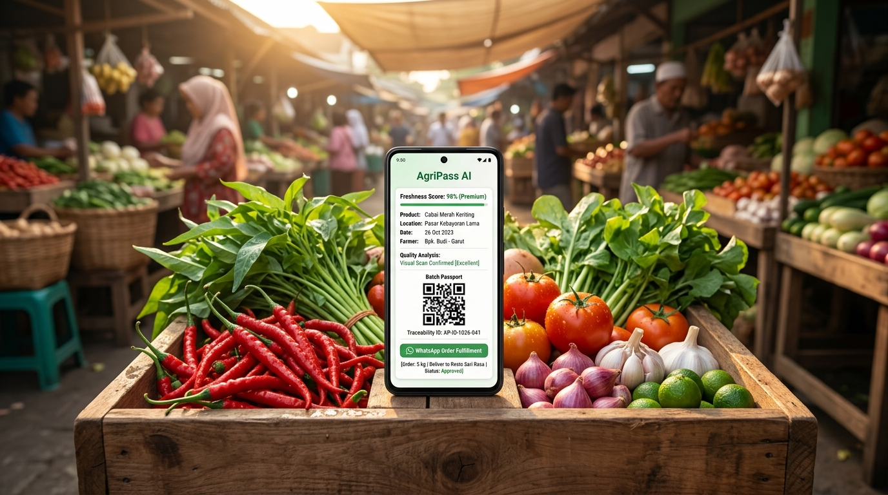
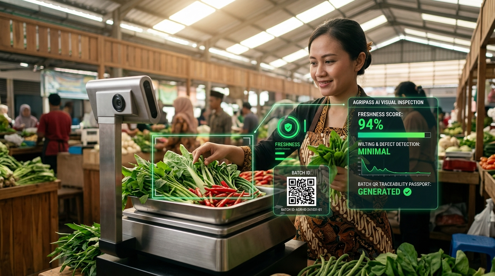
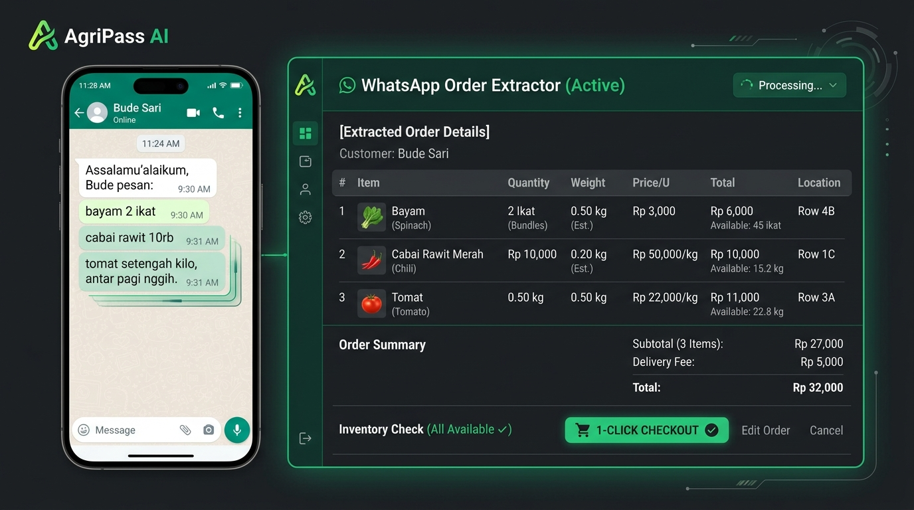
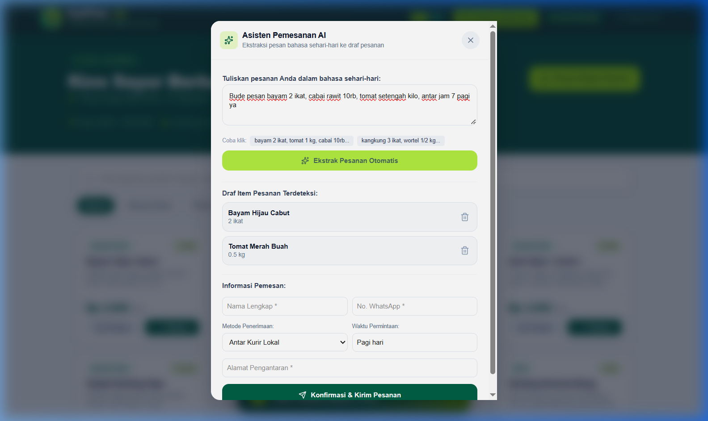
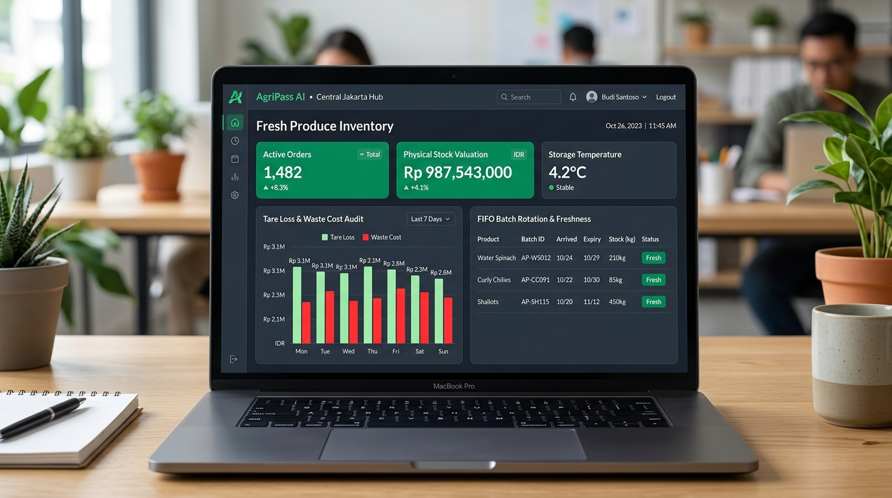
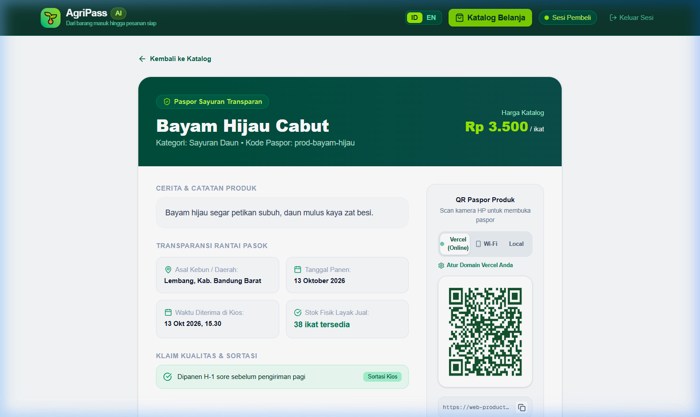
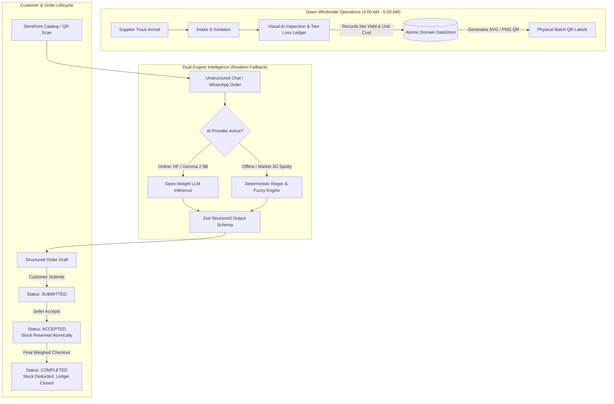

# 🥦 AgriPass AI

<p align="center">
  
</p>

<p align="center">
  <strong>From Dawn Intake to Dispatched Orders — The Zero-Shrinkage Operating System for Fresh Produce Vendors.</strong><br />
  <em>Powered by Open-Weight AI (Gemma 2), Offline-First Fallback, Real-time Tare Loss Calculations, and Instant Batch QR Passports.</em>
</p>

<p align="center">
  <a href="https://web-production-43e15.up.railway.app"></a>
  <a href="https://github.com/yandri918/agripass"></a>
  <a href="https://dev.to/challenges/hacktoberfest-week2-2026-10-12"></a>
  <a href="https://semgrep.dev"></a>
  <a href="https://nextjs.org"></a>
</p>

---

## 🌟 Executive Summary

Every morning between 4:00 AM and 7:00 AM, hundreds of thousands of independent vegetable stall owners, suburban CSA operators, and wholesale fresh produce vendors across emerging markets face two quiet margin-killers:

1. **The 15–25% Shrinkage Blindspot:** High tare loss from wet leaves, sorting discards, soil clinging, and transit bruising means gross intake does *not* equal saleable inventory. Sellers calculate unit costs against received gross weight, unknowingly selling prime produce below true break-even.
2. **The 5:00 AM WhatsApp Order Rush:** Customers blast messy, ambiguous informal messages (*"chili 10k, spinach 2 bunches, 1kg ripe tomatoes deliver to Dahlia 4B afternoon"*). Stalls spend 45–60 minutes manually cross-checking inventory, forgetting items, confusing chili varieties, and overbooking depleting stocks.

**AgriPass AI** transforms this daily chaos into a sleek, automated micro-SaaS operating system. Combining **Open-Weight AI (Google Gemma 2 9B)** with a **100% Offline Deterministic Rule-Based Fallback**, AgriPass runs flawlessly even in bustling traditional markets with spotty cellular coverage.

---

## 🔗 Live Application & Demos

| Surface | Live Link | Description |
| :--- | :--- | :--- |
| **🌐 Production App** | [web-production-43e15.up.railway.app](https://web-production-43e15.up.railway.app) | Full public landing page with bilingual switcher (`?lang=en` / `?lang=id`). |
| **🛒 Buyer Storefront** | [/toko/berkah-mandiri](https://web-production-43e15.up.railway.app/toko/berkah-mandiri) | Customer catalog, real-time stock counters, and AI WhatsApp Order Drafter drawer. |
| **🔐 Seller Operations Hub** | [/seller](https://web-production-43e15.up.railway.app/seller) *(PIN: `1234`)* | 4-tab control plane: Live Orders, Stock Overview, Dawn Intake & Loss, and Produce Config. |
| **🏷️ Product Passport** | [/produk/prod-tomat-buah](https://web-production-43e15.up.railway.app/produk/prod-tomat-buah) | Transparent farm origin, harvest timestamps, quality badges, and public AI Q&A. |
| **📦 Batch QR Passport** | [/batch/b-bayam-01](https://web-production-43e15.up.railway.app/batch/b-bayam-01) | Cryptographic QR target tracking specific batch sortation and freshness lifespan. |
| **📝 DEV.to Submission** | [Read Article](./DEVTO_SUBMISSION_WEEK2.md) | Official writeup for the Hacktoberfest Open-Source AI Challenge (Side Hustle). |

---

## 📸 Key Features Showcase

### 1. Visual Produce Quality & Freshness Inspection
Inspect incoming vegetables using computer vision or snapshot uploads. AgriPass analyzes leaf discoloration, stem turgidity, wilting percentage, and surface defects to estimate an actionable Freshness Index (0–100%), predicted discard rate, and dynamic discount recommendations.

<p align="center">
  
</p>

### 2. Conversational WhatsApp Order Drafter
Paste unstructured morning customer messages directly into the AI Order Drafter. The dual-engine AI identifies commodities, normalizes colloquial Indonesian units (*"iket"*, *"loncat"*, *"biji"*), converts currency-based amounts (*"cabai 10 ribu"*) into target gram weights, spots variety ambiguities (Red Curly vs. Bird's Eye Chili), and drafts delivery details with single-click checkout.

<p align="center">
  
  
</p>

### 3. Dawn Intake & Tare Loss Calculator (FIFO Inventory)
Records gross weight received, initial sorting discard (decayed leaves, broken stems), and incidental packaging tare. Automatically computes:
$$\text{Net Saleable Yield} = \text{Gross Intake} - \text{Sortation Loss}$$
$$\text{Actual Unit Cost} = \frac{\text{Purchase Cost} + \text{Logistics Fee} + \text{Prep Fee}}{\text{Net Saleable Yield}}$$

Includes an **Editable Commodity Input** equipped with auto-suggesting datalists for 19 staple Indonesian vegetables (*Kangkung, Bayam, Cabai Rawit, Wortel, etc.*) or arbitrary new farm produce. Internal wholesale costs and vendor margins are strictly isolated behind PIN protection and never leaked to public endpoints.

<p align="center">
  
</p>

### 4. Dynamic Batch QR Passports
Each intake generates a scannable, mobile-responsive QR code ready to print onto produce crates, plastic clamshells, or market displays. Customers scan the code to inspect harvest origin, transit timeline, and chemical-free washing certifications, boosting consumer trust and commanding premium pricing.

<p align="center">
  
</p>

### 5. Atomic Stock Reservation Engine
Prevents walk-in customer stockouts while servicing morning chat orders. When a seller moves an order from `SUBMITTED` to `ACCEPTED`, required stock is atomically placed into `reserved` status. Only upon weighing scale completion (`COMPLETED`) is physical inventory decremented. If cancelled (`CANCELLED`), stock returns to the saleable pool instantly.

---

## 🏗️ System Architecture



---

## 🛡️ Security Posture & Semgrep SAST Audit

AgriPass was audited with **Semgrep SAST** across all TypeScript, JSX, and backend route handlers:

- **Scan Coverage:** 61 files analyzed against 219 static analysis rules.
- **Audit Result:** **0 Vulnerabilities / 0 Blocking Issues**.
- **ReDoS Prevention:** Dynamic regex matchers in `lib/ai/service.ts` are strictly protected using an `escapeRegex` sanitizer to eliminate Regular Expression Denial of Service risks.
- **Role Isolation & Data Privacy:** Purchase costs (`unitCost`, `purchasePrice`), supplier contact phone numbers, and profit margin formulas are stripped on the server side before serving public product or batch passport endpoints.
- **PIN-Protected Operations:** The Seller Hub (`/seller`) is guarded by a client-session PIN authenticator (`DEFAULT_PIN = 1234`) with immediate lock-out on failure.

```text
┌──────────────┬──────────────────┬──────────────┐
│ Scan Rules   │ Files Audited    │ Findings     │
├──────────────┼──────────────────┼──────────────┤
│ 219 Rules    │ 61 Code Files    │ 0 Blocking   │
└──────────────┴──────────────────┴──────────────┘
Status: Verified Clean (Production-Ready)
```

---

## 🌐 Dual-Engine AI Architecture

AgriPass supports both cutting-edge open-weight models and zero-dependency local parsing:

1. **Open-Weight Gemma 2 (9B-it):** Configured out-of-the-box via Hugging Face Inference API or local Ollama instances. Provides human-like conversational extraction, contextual reasoning for vegetable substitutes, and polite clarifying questions.
2. **Deterministic Offline Fallback:** When internet connections drop in underground or rural markets, AgriPass activates a hand-tuned regex and fuzzy tokenization parser. It matches Indonesian vegetable keywords, parses numeric weights (`kg`, `gram`, `ikat`, `ons`), and extracts recipient addresses with **zero cloud dependencies and 0 ms latency**.
3. **Zod Structured Schema:** Both engines feed into identical, strictly-typed Zod output contracts (`OrderDraftOutputSchema`), ensuring downstream order processing never breaks.

---

## 💻 Tech Stack

- **Runtime & Framework:** [Next.js 16.4](https://nextjs.org/) (App Router, Turbopack)
- **UI Library:** [React 19](https://react.dev/)
- **Programming Language:** [TypeScript 5.9+](https://www.typescriptlang.org/)
- **Styling:** [Tailwind CSS v4](https://tailwindcss.com/)
- **Data Validation:** [Zod](https://zod.dev/)
- **Icons:** [Lucide React](https://lucide.dev/)
- **QR Code Engine:** [qrcode](https://www.npmjs.com/package/qrcode) (high-resolution SVG/PNG data URI generator)
- **Security Scanner:** [Semgrep SAST](https://semgrep.dev/)
- **Hosting & Infrastructure:** [Railway](https://railway.app/) (Containerized Node.js runtime)

---

## ⚡ Quickstart Guide

### 1. Prerequisites
- **Node.js** v20.x or higher
- **npm** or **pnpm**

### 2. Clone & Install
```bash
# Clone the repository
git clone https://github.com/yandri918/agripass.git
cd agripass

# Install dependencies
npm install
```

### 3. Environment Configuration
Create a `.env.local` file in the project root:

```env
# AI Engine Provider: 'huggingface' | 'gemini' | 'offline'
AI_PROVIDER=offline

# (Optional) If using Hugging Face Open-Weight Gemma 2
HUGGINGFACE_API_KEY=hf_your_token_here
HUGGINGFACE_MODEL=google/gemma-2-9b-it

# (Optional) If using Google Gemini Flash
GEMINI_API_KEY=your_gemini_api_key_here

# Application Configuration
NEXT_PUBLIC_APP_URL=http://localhost:3000
SELLER_DEFAULT_PIN=1234
```

> **Note:** If no API keys are provided, AgriPass automatically defaults to the **Offline Deterministic Fallback Engine**, enabling full order drafting and catalog exploration right away!

### 4. Run Development Server
```bash
npm run dev
```

Open [http://localhost:3000](http://localhost:3000) in your browser.

- **Landing Page:** `http://localhost:3000`
- **Buyer Storefront:** `http://localhost:3000/toko/berkah-mandiri`
- **Seller Hub (PIN: `1234`):** `http://localhost:3000/seller`
- **Vegetable Passport:** `http://localhost:3000/produk/prod-tomat-buah`

### 5. Running Production Build
```bash
npm run build
npm run start
```

---

## 📂 Project Directory Structure

```text
agripass/
├── app/
│   ├── api/
│   │   ├── ai/
│   │   │   ├── order-draft/       # Unstructured chat-to-order extraction endpoint
│   │   │   └── product-answer/    # Public produce passport Q&A endpoint
│   │   ├── orders/                # Customer order submission & tracking
│   │   ├── public/
│   │   │   ├── batches/[id]/      # Sanitized public batch passport data
│   │   │   ├── products/[id]/     # Sanitized public product info
│   │   │   └── shops/[slug]/      # Public store catalog & stock availability
│   │   ├── qr/                    # Dynamic vector/raster QR code generator
│   │   └── seller/
│   │       ├── batches/           # Dawn intake & tare loss ledger
│   │       ├── orders/            # Order state transitions & atomic stock reserve
│   │       └── products/          # Live product pricing & visibility toggles
│   ├── batch/[id]/                # Public Batch QR passport page
│   ├── produk/[id]/               # Public Product passport page with AI Q&A
│   ├── seller/                    # PIN-protected 4-tab Seller Operations Hub
│   ├── toko/[slug]/               # Mobile-first customer storefront & order drafter
│   ├── layout.tsx                 # Root layout with responsive navigation
│   └── page.tsx                   # High-converting landing page with live metrics
├── components/
│   └── Navbar.tsx                 # Global responsive navigation with i18n switcher
├── lib/
│   ├── ai/
│   │   ├── service.ts             # Dual-engine orchestrator (Gemma 2 + Offline)
│   │   └── types.ts               # Zod output contracts & ambiguity schemas
│   ├── data/
│   │   ├── seed-data.ts           # 19 staple Indonesian vegetables & sample batches
│   │   ├── store.ts               # Thread-safe in-memory domain store & FIFO logic
│   │   └── types.ts               # TypeScript domain interfaces & order states
│   └── i18n/
│       └── dictionaries.ts        # Full bilingual English & Indonesian translations
├── public/
│   └── images/                    # UI screenshots, inspection visuals & banners
└── DEVTO_SUBMISSION_WEEK2.md      # Hacktoberfest Week 2 official contest entry
```

---

## 🔌 API Reference

| Endpoint | Method | Role | Description |
| :--- | :--- | :--- | :--- |
| `/api/ai/order-draft` | `POST` | Public / Customer | Extracts items, quantities, units, and ambiguities from raw text. |
| `/api/ai/product-answer` | `POST` | Public / Customer | Grounded Q&A answering questions about harvest dates and pesticide claims. |
| `/api/public/shops/[slug]` | `GET` | Public / Customer | Fetches active catalog, store bio, and real-time available stock. |
| `/api/public/products/[id]` | `GET` | Public / Customer | Fetches individual product passport, excluding sensitive purchase costs. |
| `/api/public/batches/[id]` | `GET` | Public / Customer | Fetches batch origin, sortation timestamp, and shelf-life tracker. |
| `/api/qr` | `GET` | Public | Generates dynamic QR code image for any URL or batch identifier. |
| `/api/orders` | `POST` | Public / Customer | Submits a structured customer order into `SUBMITTED` status. |
| `/api/seller/orders` | `GET` / `PATCH` | Protected / Seller | Lists all active orders; advances order status and executes stock reservations. |
| `/api/seller/batches` | `GET` / `POST` | Protected / Seller | Queries FIFO batches and records new dawn intake with tare loss formulas. |
| `/api/seller/products` | `GET` / `POST` / `PATCH` | Protected / Seller | Manages commodity catalog, base retail prices, and visibility. |

---

## 💡 The Side Hustle Micro-SaaS Business Model

AgriPass is not just a coding exercise — it is designed as an executable micro-SaaS side hustle:

- **Target Market:** Over 1.2 million traditional market kiosks, urban farm shops, and fruit-vegetable vendors across Southeast Asia.
- **Freemium Tier ($0):** Free for 1 active stall, up to 30 batch intakes per month, and manual order drafting.
- **Pro Stall ($3.10 / month or Rp 49,000):** Unlimited batch entries, customized QR passports with vendor logo, WhatsApp auto-sync forwarding, and morning tare loss profit/loss accounting export.
- **Vendor ROI:** Saves ~45 minutes of order typing every single morning and prevents 8–12% unrecorded shrink loss. The service pays for itself within the first 48 hours of every month.

---

## 🤝 Contributing

We welcome contributions from open-source developers, agricultural enthusiasts, and AI practitioners!

1. Fork the Project (`https://github.com/yandri918/agripass/fork`)
2. Create your Feature Branch (`git checkout -b feature/AmazingFeature`)
3. Commit your Changes (`git commit -m 'feat: add AmazingFeature'`)
4. Push to the Branch (`git push origin feature/AmazingFeature`)
5. Open a Pull Request

---

## 📄 License & Acknowledgments

- **License:** Distributed under the **MIT License**. See `LICENSE` for details.
- **Contest Attribution:** Built with passion for the **[Hacktoberfest Open-Source AI Challenge: Week 2](https://dev.to/challenges/hacktoberfest-week2-2026-10-12)** (Side Hustle Theme).
- **Inspiration:** Agricultural supply chain domain knowledge drawn from real-world field experience in West Java fresh produce distribution and the [AgriSensa](https://github.com/yandri918/agrisensa-streamlit) initiative.

---

<p align="center">
  <strong>AgriPass AI — Know your produce. Share its story. Turn morning questions into confirmed orders.</strong><br />
  Made with 💚 by <a href="https://github.com/yandri918">Yandri</a>
</p>
